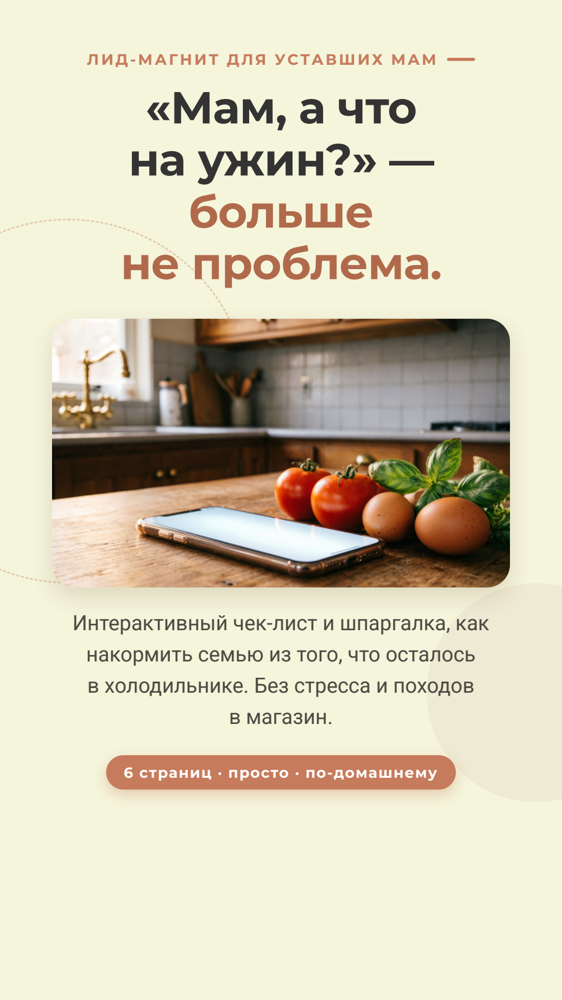
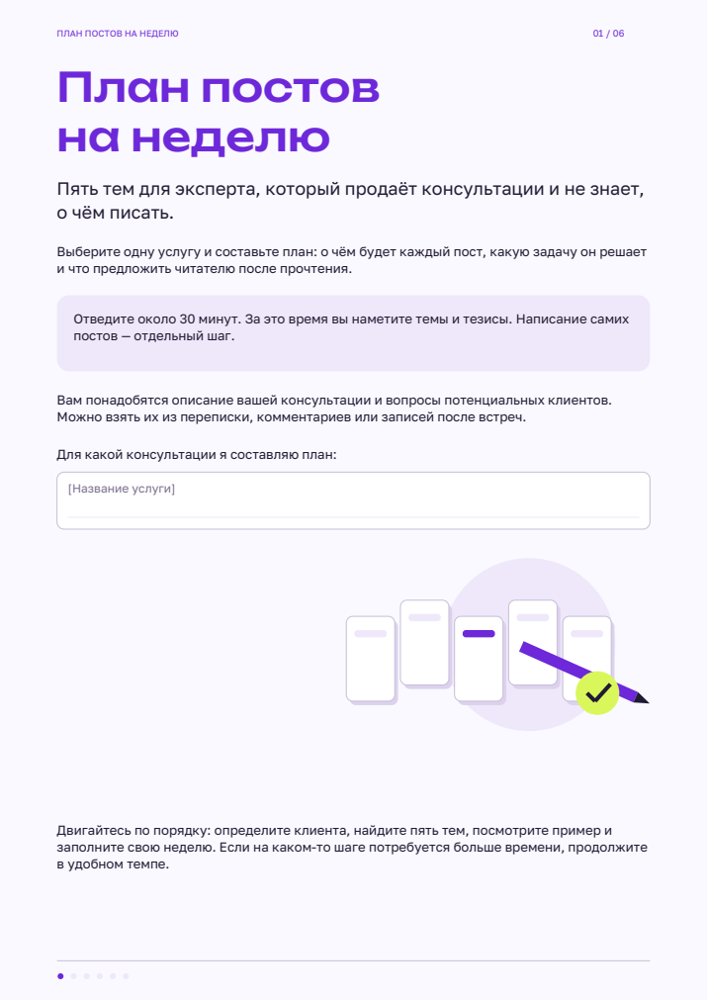
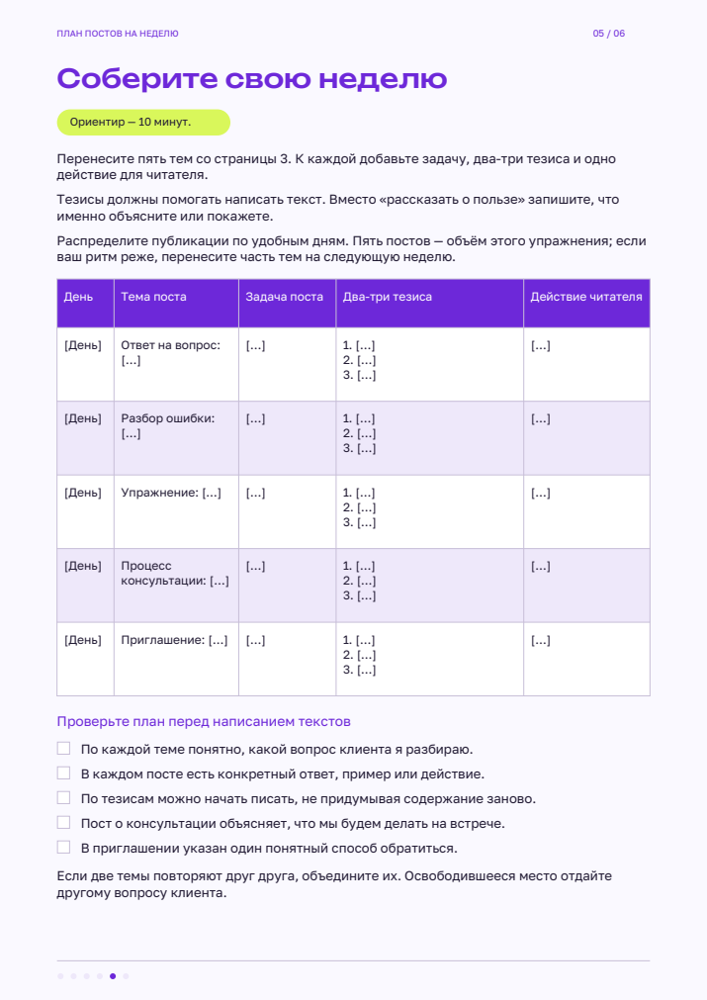

# Лид-магниты: PDF и рабочая тетрадь

Дмитрий Ширяев · два собственных учебных проекта из раздела «10 Лид магнит».
Работы выбраны автором для портфолио в заполненной тетради: кейсы №2 и №3.

## «Мам, а что на ужин?»

Шестистраничный вертикальный PDF для уставших мам: бытовая ситуация, короткий чек-лист,
пример ужина, правило сытой тарелки и переход к кулинарному помощнику ВКонтакте.
Работа показывает структуру материала, редактирование текста, фотографии и оформление.

[Открыть PDF](pdfs/dinner-checklist.pdf) · [Открыть бота](https://vk.ru/bot_shef)



## «План постов на неделю»

Шесть страниц A4 для эксперта, продающего консультации: портрет клиента, пять типов тем,
заполненный пример, таблица своей недели и пять интерактивных чекбоксов.
Результат упражнения — темы и тезисы; написание самих постов является следующим этапом.

[Открыть PDF](pdfs/content-plan-week.pdf)




## Подготовка к публикации

- В чек-листе заменена тестовая ссылка example.com на https://vk.ru/bot_shef.
- В рабочей тетради вместо заглушки формы указан действующий контакт автора:
  [Dimitryi7510@yandex.ru](mailto:Dimitryi7510@yandex.ru). Контакт кликабельный.
- Исправлен нижний отступ чек-листа на третьей странице.
- Сохранены шесть страниц каждого материала; в тетради проверены пять PDF-полей.
- Оригинальные домашние задания и рабочие тетради с персональными данными не публикуются.
- Это учебные примеры, а не отчёт о рекламной кампании: конверсия и продажи не измерялись.

## Исходники

`source/posts/` — Python-сборщик, текст, SVG и шрифты с OFL-лицензиями.
Из корня репозитория:

```bash
python -m pip install -r requirements.txt
python source/posts/build_workbook.py
```

Файл появится в `pdfs/content-plan-week.pdf`. Интерактивные чекбоксы поддерживаются
PDF-просмотрщиками с AcroForms; браузерный просмотр GitHub может их не показывать.

`source/dinner/index.html` — редактируемый HTML-макет с изображениями.
Откройте его в браузере. При отсутствии Montserrat/Roboto используются системные шрифты;
публикуемый PDF сохраняет исходное оформление. Печать макета — страницы 1080 × 1920 px,
без полей, с фоновыми изображениями.

Превью всех страниц лежат в `previews/`.

## Контакты

[Сайт](https://dmitry-shiryaev.vercel.app/) · [GitHub](https://github.com/dmmshiryaev-bit) ·
[Почта](mailto:Dimitryi7510@yandex.ru)
